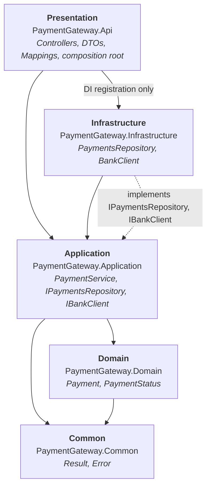
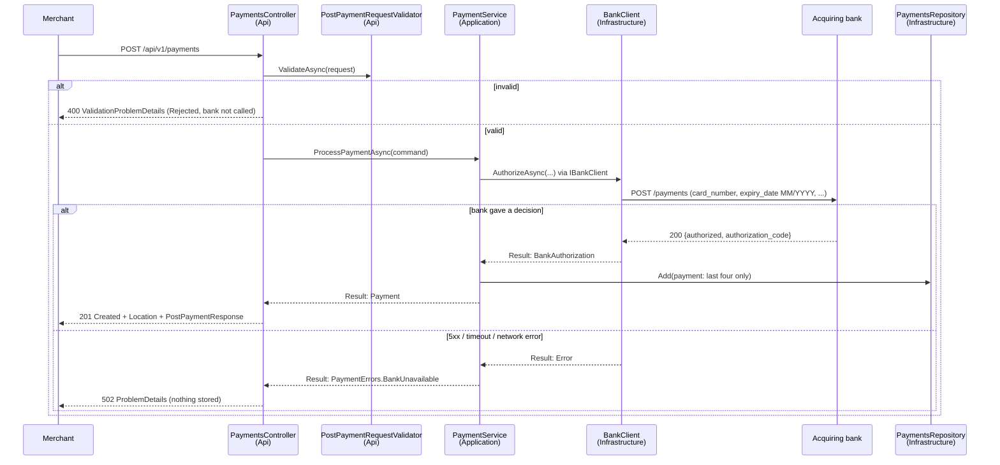

# Payment Gateway: Technical Overview

## Architecture

The solution follows **Clean / Onion Architecture**. Each layer is a separate project, so the dependency rules are enforced by the compiler through project references rather than by convention.

**The dependency rule:** source code dependencies only point **inwards**. Inner layers know nothing about outer layers. Domain has no idea there is an HTTP API or an in-memory store.

### Layers

```
┌───────────────────────────────────────────────────────────┐
│  Presentation (PaymentGateway.Api)                        │
│  Controllers · DTOs · Mappings · Program.cs               │
│   ┌───────────────────────────────────────────────────┐   │
│   │  Infrastructure (PaymentGateway.Infrastructure)   │   │
│   │  PaymentsRepository · BankClient                  │   │
│   │   ┌───────────────────────────────────────────┐   │   │
│   │   │  Application (PaymentGateway.Application) │   │   │
│   │   │  PaymentService · IPaymentsRepository     │   │   │
│   │   │  IBankClient                              │   │   │
│   │   │   ┌───────────────────────────────────┐   │   │   │
│   │   │   │  Domain (PaymentGateway.Domain)   │   │   │   │
│   │   │   │  Payment · PaymentStatus          │   │   │   │
│   │   │   └───────────────────────────────────┘   │   │   │
│   │   └───────────────────────────────────────────┘   │   │
│   └───────────────────────────────────────────────────┘   │
└───────────────────────────────────────────────────────────┘
        Common (PaymentGateway.Common): Result/Error, no dependencies
```

### Project dependencies

Solid arrows are project references ("depends on"). The dashed arrow is an interface implementation: Infrastructure implements an interface that Application owns. This is **dependency inversion**, and it is how Application can use storage without referencing Infrastructure.



| Project | Responsibility | References |
|---|---|---|
| `PaymentGateway.Domain` | Business entities and rules (`Payment`, `PaymentStatus`). No framework dependencies. | Common |
| `PaymentGateway.Application` | Use cases (`PaymentService`) and the interfaces it needs from the outside world (`IPaymentsRepository`, `IBankClient`). | Domain, Common |
| `PaymentGateway.Infrastructure` | Implementations of Application's interfaces: in-memory storage and the typed bank `HttpClient` (`BankOptions` from config). | Application |
| `PaymentGateway.Api` | HTTP concerns: routing, request and response contracts, status codes, and explicit mapping from domain to contract (`Mappings/`). Also the **composition root** that wires everything together in `Program.cs`. | Application, Infrastructure |
| `PaymentGateway.Common` | Cross-cutting building blocks shared by inner layers: `Result<T>` and `Error` for expected failures. | — |

> **Why does Api reference Infrastructure?** Only so `Program.cs` can call `AddInfrastructure()` to register implementations. Controllers depend on `IPaymentService` and never use Infrastructure types directly.

### Runtime flow: `GET /api/v1/payments/{id}`

At runtime, calls flow outside → in → out again. At compile time, every arrow still points inwards.


### Runtime flow: `POST /api/v1/payments`



### Payment outcomes

| Outcome | HTTP | Body | Stored? | Bank called? |
|---|---|---|---|---|
| **Authorized** | `201 Created` + `Location` | `PostPaymentResponse`, `status: "Authorized"` | Yes | Yes |
| **Declined** | `201 Created` + `Location` | `PostPaymentResponse`, `status: "Declined"` | Yes | Yes |
| **Rejected** (invalid request) | `400 Bad Request` | `ValidationProblemDetails` with camelCase field errors | No | **No** |
| **Bank unavailable** (5xx, timeout, network error) | `502 Bad Gateway` | `ProblemDetails` | No | Yes, no decision returned |
| **Repeated `Idempotency-Key`**, same request | `201 Created` + same `Location` | The original `PostPaymentResponse` | Already stored | **No** |
| **Repeated `Idempotency-Key`**, different request | `422 Unprocessable Entity` | `ProblemDetails` | No | **No** |
| **Same `Idempotency-Key`** while the first request is still running | `409 Conflict` | `ProblemDetails` | No | **No** |

Decisions behind this:

- **Declined is a success at the HTTP level.** The gateway did its job: a payment was created and the bank made a decision. `status` carries the business outcome.
- **Rejected returns 400 and creates nothing.** The brief says no payment is created when invalid information is supplied, so there is no resource to return or retrieve later.
- **Bank unavailable returns 502, not 500.** The gateway is healthy but its upstream failed. Nothing is stored because the bank gave no decision, so the merchant can safely retry. Before giving up, the gateway retries the bank itself, but only when that is safe (see below).
- **Expected outcomes are `Result<T>`, not exceptions.** `BankClient` turns HTTP failures into an `Error`, and the service and controller handle it explicitly. Exceptions are reserved for bugs.
- **Card data:** the full card number and CVV go to the bank only. The stored `Payment` keeps the last four digits. The bank's `authorization_code` is stored but not returned to merchants.
- **Bank settings** (`Bank:BaseUrl`, `Bank:Timeout`) come from configuration and are validated at startup, so a misconfigured deployment fails fast instead of on the first payment.

### Retrying the bank (Polly)

The bank `HttpClient` has a **Polly** retry strategy, added with `AddResilienceHandler` (`Microsoft.Extensions.Http.Resilience`, Polly v8) in `Infrastructure/DependencyInjection.cs`. `BankClient` itself has no retry code: it only sees the final response.

**Retrying a payment can charge a card twice.** If the bank authorised the payment but its response never reached us, a retry sends a second authorisation. So the gateway retries only when the bank **cannot** have processed the request:

| Failure | Retried? | Why |
|---|---|---|
| `503 Service Unavailable` | Yes | The bank explicitly refused to handle the request. |
| Connection error (`HttpRequestError.ConnectionError`) | Yes | The request never reached the bank. |
| `500`, `502`, `504` | No | The bank, or something in front of it, may have processed the payment. |
| Timeout, or connection dropped mid-response | No | Same: the request may have been processed. |
| `4xx` | No | Retrying the same request gives the same answer. |

- **Bounded:** `Bank:MaxRetryAttempts` (default 2, at most 5, `0` turns retries off), exponential backoff from `Bank:RetryDelay` (200 ms) with jitter, so many gateway instances don't retry in lockstep.
- **`Bank:Timeout` covers all attempts together.** `HttpClient.Timeout` wraps the whole handler pipeline, so retries can never make the merchant wait longer than the timeout.
- **Each retry is logged** as a `Warning` with the correlation id: `Bank call failed (503), retry 1 of 2 in 246 ms`. Polly's own logs are set to `Error`, so only the "retries exhausted" line from Polly appears.
- **The real fix for the unsafe cases is idempotency at the bank.** If the bank honoured an idempotency key, every failure would be safe to retry. The simulator doesn't support one, so for those cases the merchant gets a `502` and decides.

### Idempotency (`Idempotency-Key` header)

A merchant whose `POST` times out on their side doesn't know whether the card was charged. Sending the same request again with the same `Idempotency-Key` is always safe: the card is charged at most once.

```
POST /api/v1/payments
Idempotency-Key: order-42
```

- **Optional.** Without the header, every request is a new payment, as before. The key is 1–64 characters: letters, digits, `.`, `_`, `-`; anything else is a `400`.
- **Same key, same request:** the original payment is returned (`201`, same `id` and `Location`) and the bank is **not** called again.
- **Same key, different request:** `422`. Reusing a key for a different payment is a merchant bug, and silently returning the old payment would hide it.
- **Same key while the first request is still with the bank:** `409`, so two concurrent retries can't both reach the bank. The key is reserved atomically (`ConcurrentDictionary.GetOrAdd`) before the bank is called.
- **No payment created (bank unavailable, 400, cancelled):** the key is freed, so the merchant can retry with the same key. Only a created payment (Authorized or Declined) is remembered.
- **Where it lives:** the logic is in `PaymentService` (Application), because "never charge twice" is a business rule. Storage is behind `IIdempotencyStore`, implemented in memory in Infrastructure, like the payments repository.
- **No card data is stored for it.** To spot "same key, different request", the store keeps a fingerprint of the request: an HMAC-SHA256 of its fields with a random per-process secret. A plain hash would not be enough, because card numbers can be brute-forced from an unkeyed hash.

**What production would add:**
- keys scoped per merchant (once there is authentication);
- an expiry, typically 24 hours;
- a shared store such as Redis or the database, so every instance sees the same keys, with the HMAC secret from a key vault;
- passing the key on to the bank, which closes the remaining gap: a bank timeout where we can't tell whether the payment went through.

### What this buys us

- **Testability:** `PaymentService` can be unit tested with a fake `IPaymentsRepository` and a fake `IBankClient`, with no HTTP or storage involved.
- **Replaceable infrastructure:** swapping the in-memory store for a database, or the bank simulator for a real acquirer, only touches Infrastructure and its DI registration.
- **Stable API contracts:** request and response DTOs live in the Api project, so the HTTP contract can change without touching the domain, and the reverse. Controllers never serialise domain entities: they map explicitly (`payment.ToGetPaymentResponse()`), so internal fields can't leak into responses by accident. Mapping is hand-written rather than AutoMapper, so it is compile-checked and easy to read.

## API contract

- **Versioned in the URL: `/api/v1/payments`.** Done with `Asp.Versioning` (`[ApiVersion(1)]` on the controller). URL versioning is the most visible option: it shows up in logs, links and Swagger, and merchants don't need to set a header. Responses include `api-supported-versions: 1.0`. Unknown versions (`/api/v2/...`) and the unversioned path return `404`. A breaking change becomes a `v2` controller next to `v1`, so existing merchants keep working until they migrate.
- **Card data is strings, not numbers.** `cardNumber`, `cvv` and `cardNumberLastFour` are strings so leading zeros survive (`"012"` must not become `12`).
- **Enums are names.** `status` is serialised as `"Authorized"` / `"Declined"` / `"Rejected"` (global `JsonStringEnumConverter`), so the contract is readable and doesn't depend on enum ordering.
- **Amounts are integers in the minor unit.** `1050` in GBP is £10.50. No floating point anywhere near money.

## Request validation

Requests are validated with **FluentValidation** (`Api/Validators/PostPaymentRequestValidator.cs`). A request that fails validation is **Rejected** and is never sent to the bank.

| Field | Rule |
|---|---|
| `cardNumber` | Required, 14–19 characters, digits only |
| `expiryMonth` | Required, 1–12 |
| `expiryYear` | Required |
| `expiryMonth` + `expiryYear` | Must not be in the past. The current month is accepted, because a card is valid until the end of its expiry month |
| `currency` | Required, 3 characters, one of `GBP`, `USD`, `EUR` (`Domain/Constants/SupportedCurrencies.cs`) |
| `amount` | Required, greater than 0 |
| `cvv` | Required, 3–4 characters, digits only |

Design notes:

- **The request DTO has nullable members**, so a missing field reaches the validator and gets a clear, field-level error, instead of silently defaulting to `0` or failing JSON deserialisation.
- **"Now" comes from an injected `TimeProvider`**, so expiry rules are tested deterministically with `FakeTimeProvider` rather than depending on the real clock.
- **One error per field** (`RuleLevelCascadeMode = CascadeMode.Stop`): an empty card number reports "required", not "required" and "wrong length" and "not numeric".
- **The validator is in the Api layer** because it validates the HTTP contract (`PostPaymentRequest`). Business rules that hold however a payment arrives belong in Domain/Application.
- **Why FluentValidation over DataAnnotations:** the cross-field expiry rule and the injected clock are awkward with attributes. Validators are plain classes that are easy to unit test.

## Observability

### Correlation id

Every request carries a correlation id, so one merchant call can be followed through every log line (and, from Phase 2, into the call to the bank).

- `CorrelationIdMiddleware` runs **first** in the pipeline.
- If the request has an `X-Correlation-Id` header with a safe value (`[A-Za-z0-9._-]`, at most 64 characters), it is used. Otherwise a new GUID is generated. Unsafe values are replaced rather than rejected, to avoid log injection and oversized headers without failing the merchant's call.
- The id is returned in the `X-Correlation-Id` response header (including on 404s and errors) and pushed into the **logging scope**, so every log line written during the request includes `CorrelationId` without any code having to pass it around.

### Logging conventions

Follow these for any new log line:

| Rule | Example |
|---|---|
| **Structured templates, never string interpolation.** Values become queryable fields. | `LogInformation("Payment {PaymentId} retrieved with status {PaymentStatus}", id, status)` |
| **Consistent property names** across the codebase. | `PaymentId`, `PaymentStatus`, `CorrelationId` |
| **Log business outcomes in the Application layer**, not in controllers. Controllers stay thin. | `PaymentService` logs found / not found |
| **Never log card data.** No PAN, no CVV, no full request bodies. The last four digits are the most that may appear. | |
| **Levels:** `Information` for normal business events (including "not found"), `Warning` for unexpected but handled situations (e.g. bank retry), `Error` for failures needing attention. | |

### Log output

- **Production** (`appsettings.json`): JSON console logs with scopes and UTC timestamps, ready for a log collector.
- **Development** (`appsettings.Development.json`): single-line, human-readable output, also with scopes.

Example (Development):

```
info: PaymentGateway.Application.Payments.PaymentService[0] => ... => CorrelationId:demo-456 => ... Payment 00000000-0000-0000-0000-000000000002 not found
```
