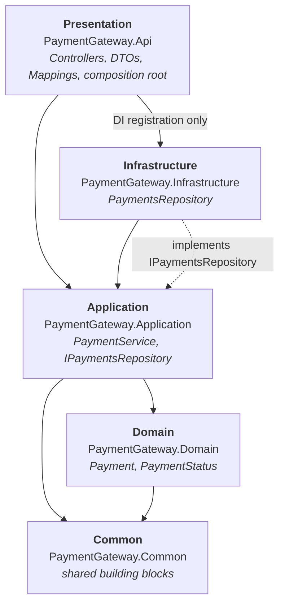
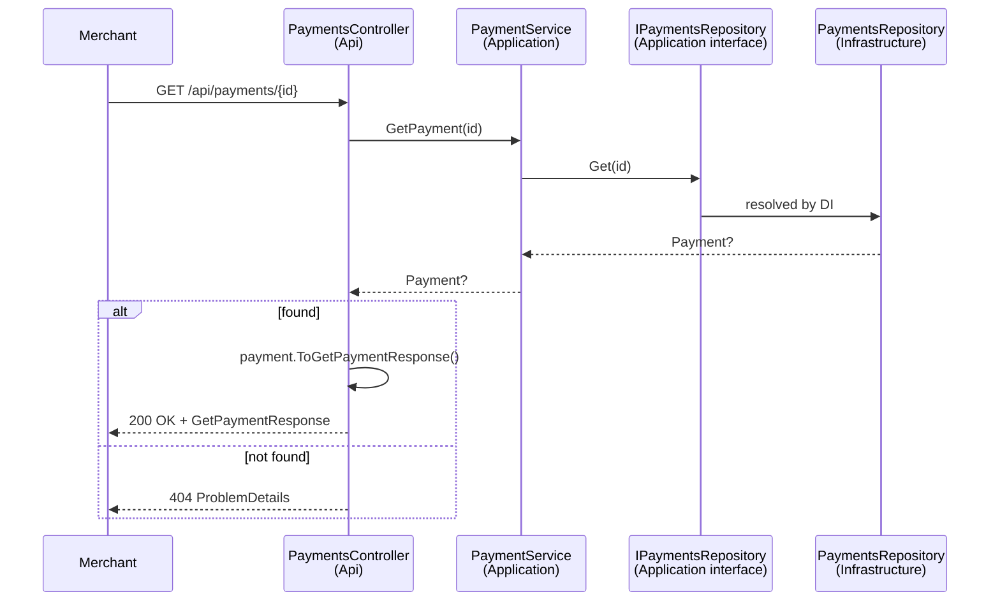

# Payment Gateway: Technical Overview

## Architecture

The solution follows **Clean / Onion Architecture**. Each layer is a separate project, so the dependency rules are enforced by the compiler through project references rather than by convention.

**The dependency rule:** source code dependencies only point **inwards**. Inner layers know nothing about outer layers. Domain has no idea there is an HTTP API or an in-memory store.

### Layers

```
┌───────────────────────────────────────────────────────────┐
│  Presentation (PaymentGateway.Api)                        │
│  Controllers · DTOs · Mappings · Program.cs               │
│   ┌───────────────────────────────────────────────────┐   │
│   │  Infrastructure (PaymentGateway.Infrastructure)   │   │
│   │  PaymentsRepository · (later) BankClient          │   │
│   │   ┌───────────────────────────────────────────┐   │   │
│   │   │  Application (PaymentGateway.Application) │   │   │
│   │   │  PaymentService · IPaymentsRepository     │   │   │
│   │   │   ┌───────────────────────────────────┐   │   │   │
│   │   │   │  Domain (PaymentGateway.Domain)   │   │   │   │
│   │   │   │  Payment · PaymentStatus          │   │   │   │
│   │   │   └───────────────────────────────────┘   │   │   │
│   │   └───────────────────────────────────────────┘   │   │
│   └───────────────────────────────────────────────────┘   │
└───────────────────────────────────────────────────────────┘
        Common (PaymentGateway.Common): shared, no dependencies
```

### Project dependencies

Solid arrows are project references ("depends on"). The dashed arrow is an interface implementation: Infrastructure implements an interface that Application owns. This is **dependency inversion**, and it is how Application can use storage without referencing Infrastructure.



| Project | Responsibility | References |
|---|---|---|
| `PaymentGateway.Domain` | Business entities and rules (`Payment`, `PaymentStatus`). No framework dependencies. | Common |
| `PaymentGateway.Application` | Use cases (`PaymentService`) and the interfaces it needs from the outside world (`IPaymentsRepository`). | Domain, Common |
| `PaymentGateway.Infrastructure` | Implementations of Application's interfaces: storage now, the bank HTTP client later. | Application |
| `PaymentGateway.Api` | HTTP concerns: routing, request and response contracts, status codes, and explicit mapping from domain to contract (`Mappings/`). Also the **composition root** that wires everything together in `Program.cs`. | Application, Infrastructure |
| `PaymentGateway.Common` | Cross-cutting building blocks shared by inner layers. | — |

> **Why does Api reference Infrastructure?** Only so `Program.cs` can call `AddInfrastructure()` to register implementations. Controllers depend on `IPaymentService` and never use Infrastructure types directly.

### Runtime flow: `GET /api/payments/{id}`

At runtime, calls flow outside → in → out again. At compile time, every arrow still points inwards.



### What this buys us

- **Testability:** `PaymentService` can be unit tested with a fake `IPaymentsRepository` (and later a fake bank client), with no HTTP or storage involved.
- **Replaceable infrastructure:** swapping the in-memory store for a database, or the bank simulator for a real acquirer, only touches Infrastructure and its DI registration.
- **Stable API contracts:** request and response DTOs live in the Api project, so the HTTP contract can change without touching the domain, and the reverse. Controllers never serialise domain entities: they map explicitly (`payment.ToGetPaymentResponse()`), so internal fields can't leak into responses by accident. Mapping is hand-written rather than AutoMapper, so it is compile-checked and easy to read.

## API contract

- **Card data is strings, not numbers.** `cardNumber`, `cvv` and `cardNumberLastFour` are strings so leading zeros survive (`"012"` must not become `12`).
- **Enums are names.** `status` is serialised as `"Authorized"` / `"Declined"` / `"Rejected"` (global `JsonStringEnumConverter`), so the contract is readable and doesn't depend on enum ordering.
- **Amounts are integers in the minor unit.** `1050` in GBP is £10.50. No floating point anywhere near money.

## Request validation

Requests are validated with **FluentValidation** (`Api/Validators/PostPaymentRequestValidator.cs`). A request that fails validation is **Rejected** and is never sent to the bank.

| Field | Rule |
|---|---|
| `cardNumber` | Required, 14–19 characters, digits only |
| `expiryMonth` | Required, 1–12 |
| `expiryYear` | Required |
| `expiryMonth` + `expiryYear` | Must not be in the past. The current month is accepted, because a card is valid until the end of its expiry month |
| `currency` | Required, 3 characters, one of `GBP`, `USD`, `EUR` (`Domain/Constants/SupportedCurrencies.cs`) |
| `amount` | Required, greater than 0 |
| `cvv` | Required, 3–4 characters, digits only |

Design notes:

- **The request DTO has nullable members**, so a missing field reaches the validator and gets a clear, field-level error, instead of silently defaulting to `0` or failing JSON deserialisation.
- **"Now" comes from an injected `TimeProvider`**, so expiry rules are tested deterministically with `FakeTimeProvider` rather than depending on the real clock.
- **One error per field** (`RuleLevelCascadeMode = CascadeMode.Stop`): an empty card number reports "required", not "required" and "wrong length" and "not numeric".
- **The validator is in the Api layer** because it validates the HTTP contract (`PostPaymentRequest`). Business rules that hold however a payment arrives belong in Domain/Application.
- **Why FluentValidation over DataAnnotations:** the cross-field expiry rule and the injected clock are awkward with attributes. Validators are plain classes that are easy to unit test.
